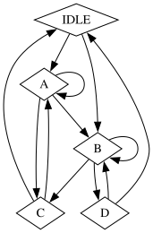

SystemVerilog Graph
===================

* Tool to edit test Graphs and generate SystemVerilog graph randsequence
* Tool to run randsequence efficiently

Concept to be developped:
=========================

Inputs:

* CSV File with state, next_state columns
* Graph defined as a Graphviz file (TBD)
* Graphical User Interface to generate the Graphviz

Outputs:

* A UVM Sequence, using randsequence which:
    * use ransequence to implement the graph
    * has action functions and tasks for each:
        * nodes
        * edges
    * has constrainable weight for each edge
    * reduces weight of the eidge when they are executed, accelerating the overall graph coverage closure
    * has state and transition coverage
    * stops when a maximum number of iterations is reached
    * stops when coverage is 100%
    * allow users to extend the class and implement each action and call UVM sequences.

Example:
========

CSV File
```
state,next_state
A,A
A,B
A,C
B,B
B,C
B,D
IDLE,A
IDLE,B
C,A
C,IDLE
D,B
D,IDLE
```

or
GraphViz
```dot
digraph FSM {
    
    node [shape=diamond];    
    rank=max;
    IDLE;

    rank=med;
    // --selections--
    A -> {A B C};
    B -> {B C D};
    IDLE -> {A B};
    C    -> {A IDLE };
    D    -> {B IDLE };

}
````




is converted to 

[examples/completeness/randseq_example.sv](examples/completeness/randseq_example.sv)

<iframe src="examples/completeness/randseq_example.sv">
</iframe>
